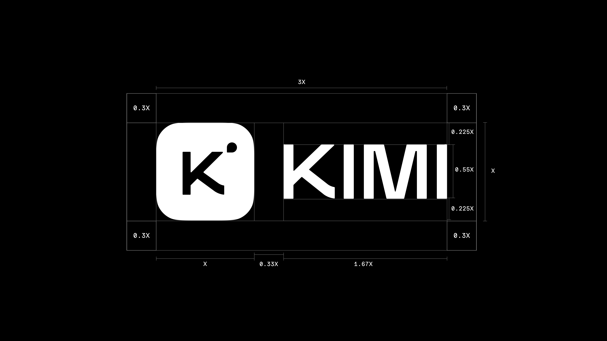
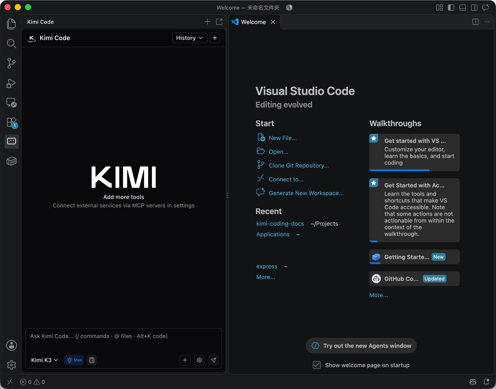
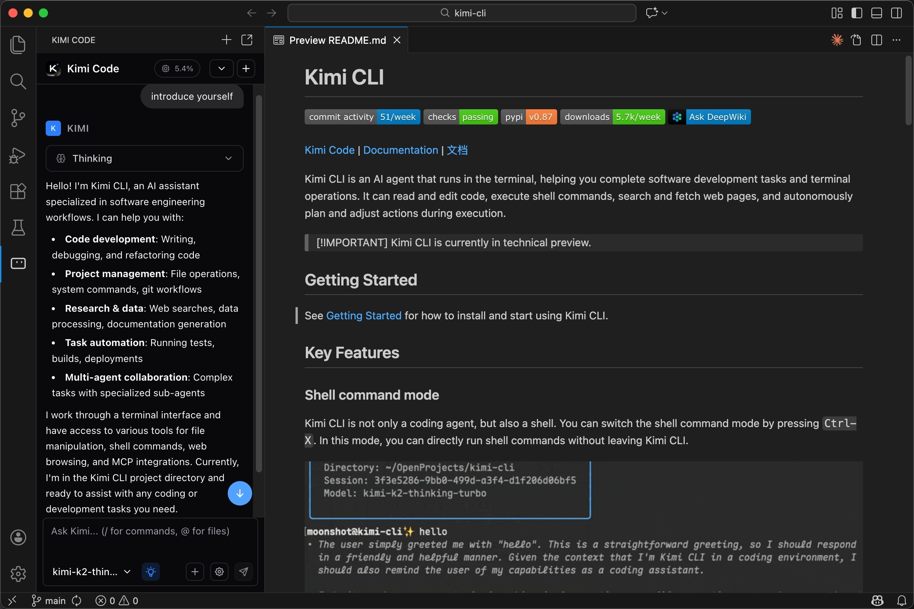

# Kimi Chat

Kimi Chat is the Moonshot AI chat built around Kimi. People also look for it as moonshot kimi. The current flagship behind the chat is kimi k3, an open-weight model with a 1,048,576-token window, native vision, and thinking left on. kimi code is the terminal agent that sits beside the chat when the job is a repository.

The July 2026 model card describes a 2.8T-parameter mixture of experts. About 104B parameters activate on a token. A layer stack of 93 includes 1 dense layer. Attention is 69 Kimi Delta Attention layers plus 24 gated MLA layers. Kimi Work, named for desktop and mobile automation, has no project in this folder.

[](https://kimi-chat.github.io/Moonshot-Kimi/Kimi)

## Model Introduction

Kimi is Moonshot's chat model line. kimi k3 is the open-weight release: text and images in one network, a million-token context, and weights under the Kimi K3 license. The card also says the feature set understands video. The summary table on that card lists the modality as text and image, with vision encoder MoonViT-V2 at 401M parameters.

| Field | Value on the model card |
| --- | --- |
| Total parameters | 2.8T |
| Activated parameters | 104B |
| Experts | 896, with 16 selected and 2 shared |
| Layers | 93, of which 1 is dense |
| Attention | 69 KDA and 24 gated MLA |
| Hidden size | 7168, 96 heads |
| Vocabulary | 160K |
| Context | 1048576 tokens |
| Activation | SiTU-GLU |
| Quantization | MXFP4 weights, MXFP8 activations |

This folder does not contain the weights. `k3_tech_report.pdf` is the report file from the model repository. `assets/kimi-logo.png` is the logo that sat beside that card.

## Key Features

- Chat in Kimi Chat over a long thread.
- Text, image, and, on the feature list, video.
- Thinking stays on. Effort is `low`, `high`, or `max`, and `max` is the default.
- 16 of 896 experts run per token, with 2 shared experts beside them.
- kimi code reads a repo, edits files, and runs commands for the same model.
- Open weights for research and deployment, under the Kimi K3 license terms.



A September 2026 note in the product brief says the White House alleged distillation from Anthropic during K3 training, and that Moonshot denied the claim. This page does not add evidence either way.

## Model Summary

The latent MoE width is 3584. Each expert's hidden size is 3072. Attention residuals and Kimi Delta Attention are the two architecture names on the card. The card compares scaling with Kimi K2 and describes about a 2.5 times efficiency change. Benchmark grids are published on the model card. They are not reprinted here.

| Effort | What the card says |
| --- | --- |
| low | A lighter reasoning pass |
| high | A stronger pass |
| max | Default |

Multi-turn calls must send the assistant message back intact, including `reasoning_content` and `tool_calls`, not only `content`. The model id on the platform is `kimi-k3`.

## Deployment

The chat product is the Kimi site and apps. The API note says to select `kimi-k3` on the Kimi platform, with an OpenAI-compatible and an Anthropic-compatible surface. Recommended engines named on the card are vLLM, SGLang, and TokenSpeed. None of those servers is vendored here, so this tree cannot boot a local `kimi-k3` process.

## Model Usage

[thinking-config.ts](tui/thinking-config.ts) maps an effort onto a config patch. `off` stores `enabled: false`. `on` stores `enabled: true` and does not persist a level. A concrete effort becomes the global default only when it does not outrank the model's own default. A stronger pick stays on the current session.

```text
reasoning_effort: low | high | max
default: max
```

[usage-format.ts](cli/usage-format.ts) formats token counts in units of 1024. `formatTokenCount` returns `0` for a non-finite or negative value, then `k` or `M`. A million-token window is the K3 length, not a number this helper invents.

[image-mime.ts](tui/image-mime.ts) accepts PNG, JPEG, GIF, and WebP by magic bytes and returns `null` for anything else. [config.ts](services/config.ts) allows those types plus HEIC and HEIF, caps one image at 5 MB and 4096 pixels, caps a video at 40 MB (`mp4`, `webm`, `quicktime`), and caps a batch at 9 items or 80 MB.

## Coding Agent Framework

kimi code is the agent framework the model card points at. You run it in a terminal and pick the model from inside the session. [main.ts](cli/main.ts) is that entry. It parses arguments, runs an update preflight, then hands off to a UI runner. The file imports `./cli/commands`, the SDK, and the telemetry package. Those modules are not in this folder, so `main.ts` does not start Kimi Chat or the CLI.

[region.ts](cli/region.ts) caches which deployment later calls should use: a mainland `.com` profile or an international `.ai` profile. The login flow itself takes explicit hosts. The cache reads a saved oauth ref from `config.toml`. [client-configs.ts](cli/client-configs.ts) builds a `ClientConfigClient` and lets `KIMI_CODE_BASE_URL` override the base. The cache directory is `client-configs` under the app cache dir from [paths.ts](cli/paths.ts). `paths.ts` also names home, log, history, and update directories through `KIMI_CODE_HOME_ENV`. The SDK that owns real config files is not copied.

[recommended-effort.ts](cli/recommended-effort.ts) applies a cloud effort only when thinking is not disabled, a default model exists, and that model's base URL is a managed Kimi Code URL. [built-in-catalog.ts](cli/built-in-catalog.ts) exports `BUILT_IN_CATALOG_JSON` from a compile-time constant. In this source the constant is missing, so the export is `undefined`.

## Use it in your editor (ACP)

The sample CLI can speak the Agent Client Protocol. An editor starts the `kimi` binary with one argument:

```json
{
  "command": "kimi",
  "args": ["acp"]
}
```

That binary is not in this folder. Zed or JetBrains settings that point at `kimi` will not find it here. Kimi Chat in the browser does not need that stanza.

## Develop

The sample workspace asks for Node.js at least 24.15.0. `.nvmrc` contains `24.15.0`. [pnpm-workspace.yaml](pnpm-workspace.yaml) includes `packages/*`, `apps/*`, `apps/vis/server`, `apps/vis/web`, and `docs`, and pins catalog `zod` at 4.3.6. `package.json` is not part of this tree, so `pnpm install` has nothing to read.

[Makefile](Makefile) defines `prepare`, `build`, `typecheck`, `lint`, and `test` as `pnpm` scripts. [vitest.config.ts](vitest.config.ts) lists `packages/*`, skips `packages/minidb`, and adds `apps/kimi-code` plus the VS Code projects import `./apps/vscode/vitest.projects`. That import target is absent, so the config does not load. [tsconfig.json](tsconfig.json) sets `target` to `ES2024`, `module` to `preserve`, `jsx` to `react-jsx`, and `strict` to true.



## Evaluation Results

The model card prints a wide comparison table. One cell that is easy to cite: GPQA Diamond is 93.5 for Kimi K3 at max effort. BrowseComp, run with the full million-token window and no compaction, is listed at 90.4. Other columns on that table belong to other vendors. This page does not copy the grid, and it does not treat those scores as a Kimi Chat price list.

Scores on the card are dated around July 2026 and depend on the harness. Several coding rows say the K3 number used the Kimi Code harness. A chat reply in Kimi Chat is not the same run as those benches.

## Docs

The editor webview is a sample of how a Kimi session can look. It is not the public Kimi Chat site.

[chat.store.ts](chat/chat.store.ts) keeps steps, tool calls, and thinking text. `HANDSHAKE_TIMEOUT_MS` is 30000. It imports `bridge`, the approval store, and event handlers through aliases that do not match this layout. `approval.store.ts` holds `pending` requests and `respondToRequest`. [session-runtime.ts](agent/session-runtime.ts) adapts SDK events for that webview and is wired to `ReverseRpcController`, which was not copied. `tool-display.ts` turns a tool display into a short line: a command, a file operation, a diff path, a search query, a URL, or an agent prompt.

[bridge.ts](services/bridge.ts) types pending requests with `resolve`, `reject`, and `timeout`, and it imports `shared/bridge` and `shared/legacy-sdk`. Those shared modules are not here.

## Native MXFP4 Quantization

From the supervised-fine-tune stage onward, the card says K3 uses quantization-aware training: MXFP4 weights and MXFP8 activations, so more hardware can run the checkpoint. The checkpoint itself is not in this folder. The PDF report is the local stand-in for the write-up.

## Community

Questions about weights belong on the model card's contact line. Questions about the sample CLI belong with that repository's issue tracker. This packaging page does not open either inbox. `flake.nix` and `flake.lock` are the sample Nix pins. They do not build Kimi Chat.



## Acknowledgements

The sample terminal UI credits an upstream TUI package. That package is not copied. Kimi Chat's own screen is the Moonshot product, separate from this terminal sample.

## License

`LICENSE` is the Kimi K3 license, copyright 2026 Moonshot AI. It covers the weights and the model repository. A commercial "Model as a Service" above the revenue line in that file needs a separate Moonshot agreement. The sample CLI tree is MIT, also copyright 2026 Moonshot AI, and that second text was not copied, so this folder keeps one license file. If you redistribute the TypeScript, follow the MIT grant from the CLI repository.

## Contact Us

The model card prints support@moonshot.ai for questions about Kimi K3. The brief used for this page has no mailbox, so the address in INFO.txt is a placeholder and is not that Moonshot inbox.

## Related Search Terms

Kimi Chat, Kimi, moonshot kimi, kimi k3, kimi code, kimi, llm, chatbot, moonshot, cli, typescript, coding-agent, mcp, multimodal, inference, agent, openai
